<p align="center">
  
</p>

<p align="center">
  <b>Uma rede social de fotos feita do zero, do banco de dados à tela.</b><br>
  Projeto final full stack · Geração Tech
</p>

<p align="center">
  <a href="https://enzo-oliver.github.io/Zeon_GT-4.0/"><b>🌐 Acessar o site</b></a>
</p>

---

## O projeto

A **Zeon** é uma rede social de fotos inspirada nas que usamos todo dia: dá para **criar conta, postar, publicar stories, curtir, comentar** e visitar o perfil de outras pessoas.

Todas as partes foram construídas por mim: a interface em **React**, a API em **Node.js** e o banco de dados na nuvem. O site está publicado online e funciona no computador e no celular.

<p align="center">
  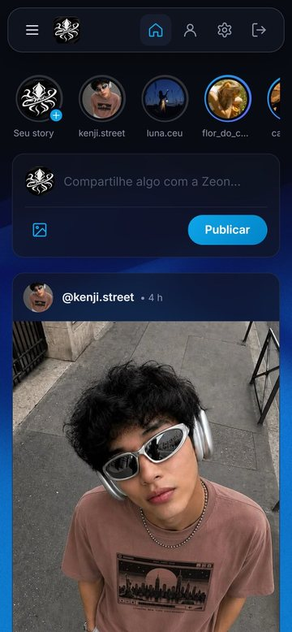
  &nbsp;
  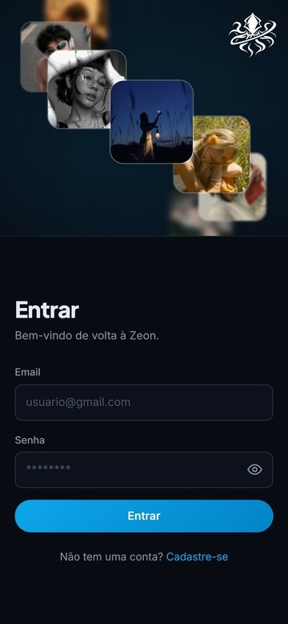
  &nbsp;
  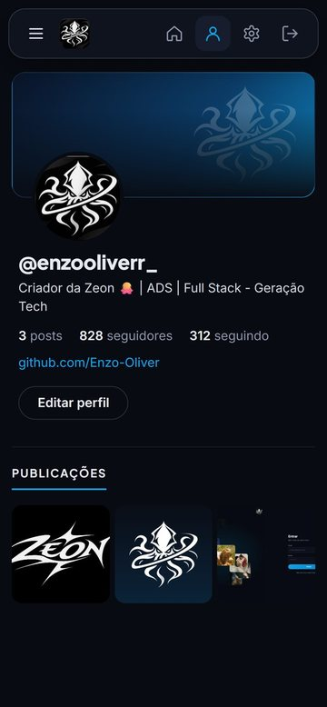
</p>

## Funcionalidades

| | |
|---|---|
| 👍 **Feed e curtidas** | Posts com foto e legenda, curtidas e há quanto tempo cada um foi publicado. |
| ⏱️ **Stories de 24 horas** | Fotos que somem sozinhas depois de um dia, vistas em tela cheia. |
| 💬 **Comentários** | Conversa em cada post; quem escreveu e o dono do post podem apagar. |
| 👤 **Perfis** | Foto, capa e bio editáveis; um clique no nome abre o perfil da pessoa. |
| ⚙️ **Conta** | Ver o email, trocar a senha e apagar a própria conta com confirmação. |
| 🛡️ **Moderação** | Conta invisível que remove conteúdo impróprio, renomeia e apaga usuários. |

## Telas

### Login
Na entrada, as fotos giram numa espiral animada. Login com email e senha, ou criar uma conta nova. Sem entrar, nenhuma outra página do site abre.

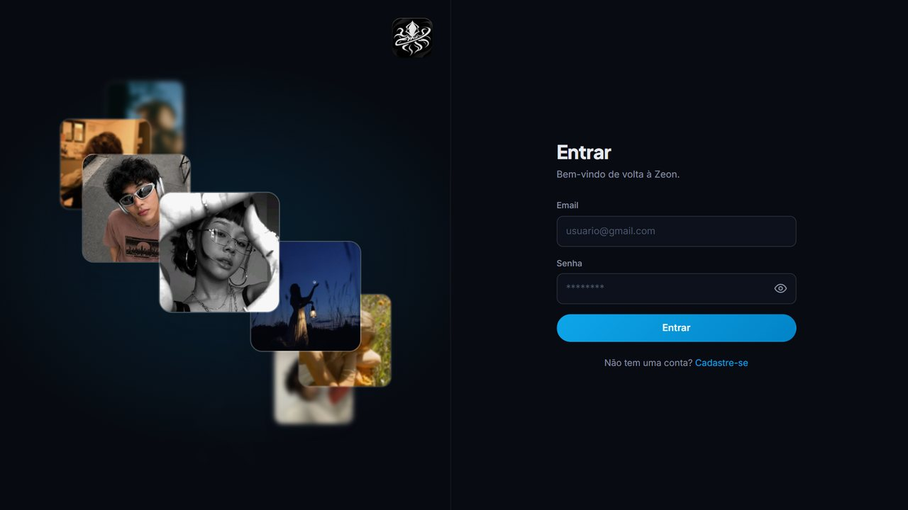

### Feed e stories
Fundo animado, posts em vidro fosco e os mais novos primeiro. Os stories abrem em tela cheia, passam sozinhos a cada 5 segundos e somem em 24 horas.

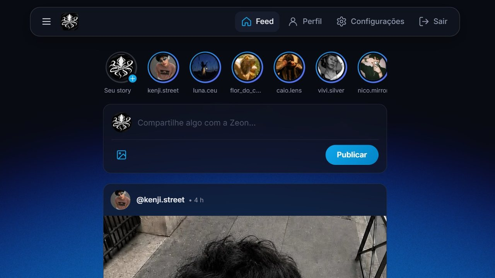 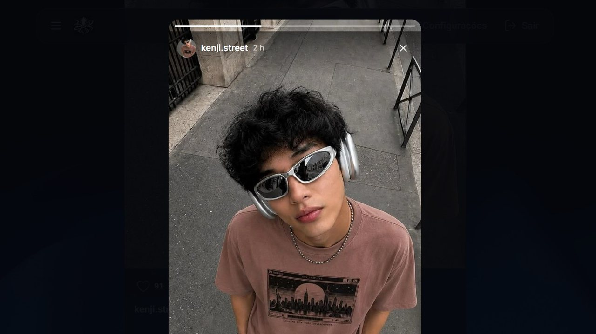

### Comentários e perfis
Cada post abre sua conversa. Um clique no nome ou na foto abre o perfil da pessoa, com bio e publicações.

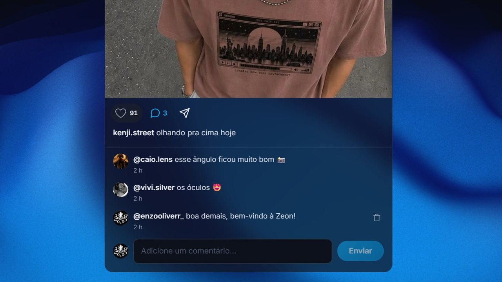 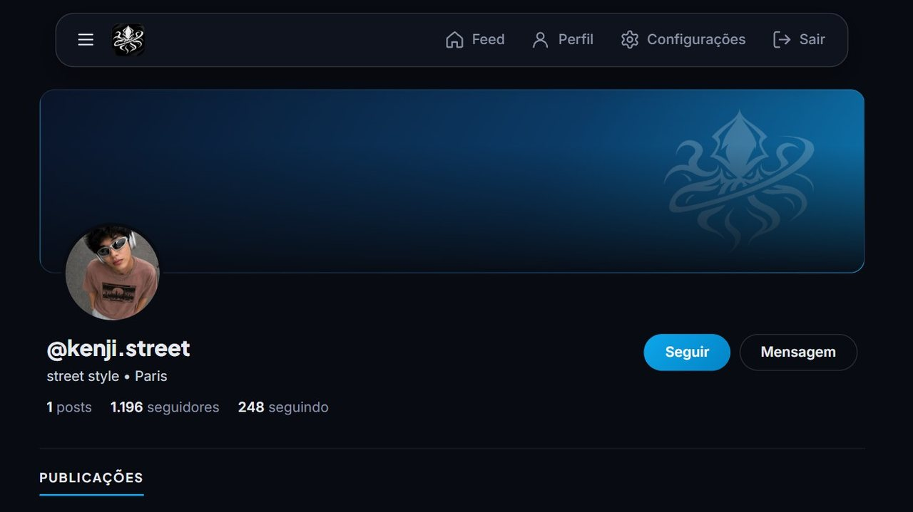

### Configurações da conta
Foto, capa, nome de usuário e bio, com prévia antes de salvar. Email, troca de senha e apagar a conta, sempre pedindo a senha.

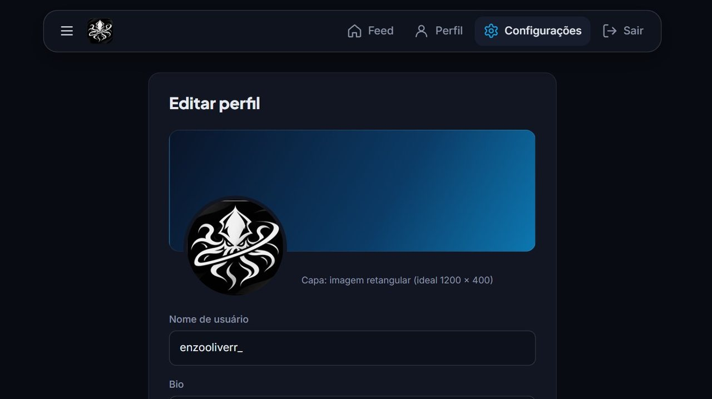 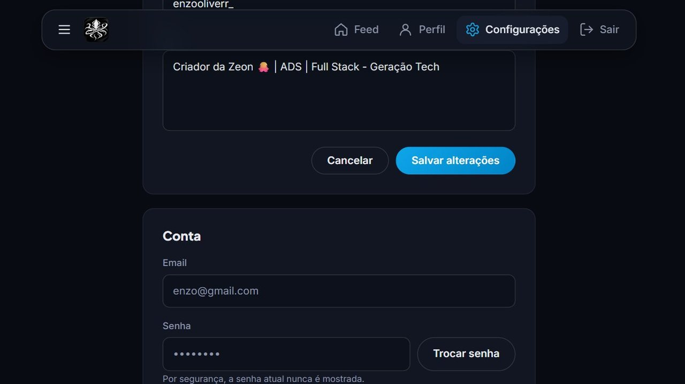

## Tecnologias

| Front-end | Back-end | Nuvem e deploy |
|---|---|---|
| **React 19** – interface em componentes | **Node.js** – onde a API roda | **MongoDB Atlas** – banco na nuvem, em São Paulo |
| **Vite 8** – build e servidor de dev | **Express 5** – rotas da API REST | **Vercel** – hospeda a API (serverless) |
| **React Router 7** – páginas e rotas protegidas | **MongoDB** – banco de dados NoSQL | **GitHub Pages** – hospeda o site |
| **CSS e Bootstrap** – tema escuro e responsivo | **Vercel Blob** – armazenamento das fotos | **GitHub Actions** – publica o site a cada push |
| **Motion e Hugeicons** – animações e ícones | **bcryptjs** – hash das senhas | |

## Arquitetura

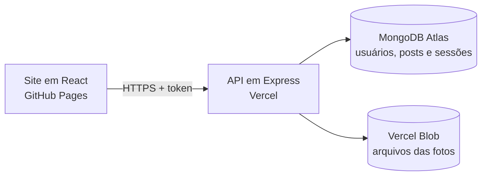

O site chama a API mandando o token de login. A API guarda os dados no MongoDB e as fotos no Vercel Blob; o banco guarda só o link de cada foto.

**Deploy automático:** cada push na branch `main` publica o site (GitHub Actions) e a API (Vercel).

## Segurança

- 🔑 **Login com token** – cada login cria uma sessão que vale 30 dias; sair encerra a sessão.
- 🔒 **Rotas protegidas** – sem login não dá para abrir as páginas nem ler dados da API.
- ⚠️ **Contra NoSQL injection** – a API recusa dados com operadores do MongoDB, como `$gt` e `$ne`.
- ✅ **Fotos validadas** – só JPG, PNG ou WebP de até 4 MB, conferindo o conteúdo real do arquivo.
- 🛡️ **Permissões** – cada pessoa só altera o que é dela; a moderação remove o que for impróprio.
- 🔐 **Senhas criptografadas** – guardadas com hash bcrypt: nem quem acessa o banco consegue ler.

## Como rodar no computador

Precisa do [Node.js](https://nodejs.org/) 22 ou mais novo, de um banco no [MongoDB Atlas](https://www.mongodb.com/atlas) e, para enviar fotos, de um Blob Store na [Vercel](https://vercel.com/).

**1. Back-end**

```bash
cd Backend
npm install
cp .env.example .env      # depois preencha MONGODB_URI e BLOB_READ_WRITE_TOKEN
node --env-file=.env servidor.js
```

A API sobe em `http://localhost:3000`. No primeiro acesso, o banco é criado com dois usuários de teste.

**2. Front-end** (em outro terminal)

```bash
cd Frontend/Projeto-final-inst
npm install
npm run dev
```

O site abre em `http://localhost:5173/Zeon_GT-4.0/` e usa a API local. Para apontar para outra API, crie um `.env` com `VITE_API_URL` (veja o `.env.example`).

### Scripts úteis do back-end

| Comando | O que faz |
|---|---|
| `node --env-file=.env admin.js email@exemplo.com` | Transforma a conta em moderadora (`--remover` tira, `--listar` mostra quem é) |
| `node --env-file=.env migrar-senhas.js --simular` | Mostra quantas senhas antigas, em texto puro, seriam convertidas para hash |
| `node --env-file=.env migrar-imagens.js --simular` | Mostra quantas fotos antigas, em base64, seriam levadas para o Vercel Blob |

Sem o `--simular`, os dois scripts de migração fazem a conversão de verdade.

## Publicação

- **API (Vercel):** projeto com *Root Directory* `Backend` e as variáveis `MONGODB_URI` e `BLOB_READ_WRITE_TOKEN`.
- **Site (GitHub Pages):** o workflow `.github/workflows/deploy.yml` faz o build e publica. Em *Settings → Pages*, a origem é **GitHub Actions**, e a variável `VITE_API_URL` (em *Settings → Secrets and variables → Actions → Variables*) guarda o endereço da API.

## Implementações futuras

- ✉️ **Mensagens diretas** – conversas privadas entre usuários, em tempo real.
- ⚡ **Notificações** – avisos de curtidas, comentários e novos seguidores.
- 🔍 **Explorar** – descobrir pessoas e posts populares, com busca por nome.
- ▶️ **Vídeos curtos** – publicar e assistir vídeos verticais direto no feed.
- 👥 **Seguir de verdade** – botão Seguir funcionando e um feed só com quem você segue.
- 🔑 **Recuperar senha** – redefinir a senha por email quando a pessoa esquecer.

## Autor

**Enzo de Oliveira Azevedo**
Estudante de Análise e Desenvolvimento de Sistemas (ADS) · Projeto full stack desenvolvido na conclusão do curso **Full Stack da Geração Tech**.

[GitHub](https://github.com/Enzo-Oliver)
